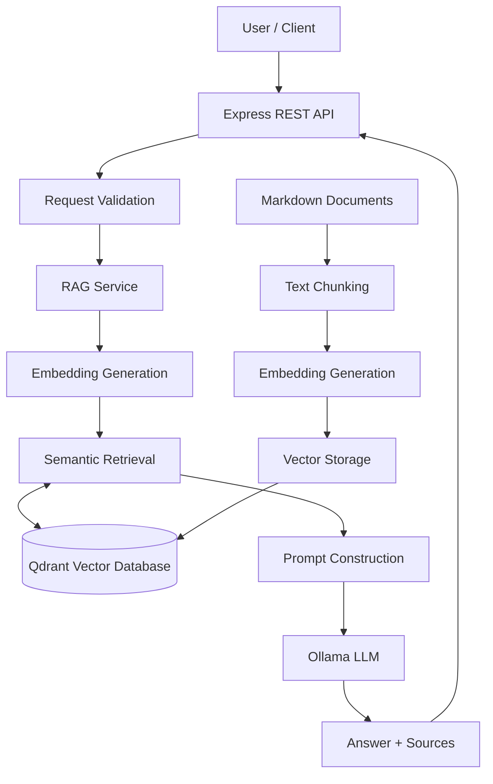

# Agentic RAG System Core

<p align="center">
  <strong>A Modular, Retrieval-Augmented AI Knowledge System</strong>
  <br />
  Grounded AI responses powered by semantic search, vector databases, and local LLM inference.
</p>

<p align="center">
  
  
  
  
  
</p>

---

## Overview

**Agentic RAG System Core** is a modular Retrieval-Augmented Generation (RAG) backend designed to transform static documents into a searchable, AI-powered knowledge base.

It combines vector-based semantic retrieval with Large Language Model (LLM) inference to generate context-aware answers grounded in relevant source documents.

The system separates document ingestion, embedding generation, vector retrieval, prompt construction, and answer generation into independent components.

Its architecture provides a foundation for intelligent knowledge assistants, internal AI tools, and domain-specific question-answering systems.

### Key Capabilities

- **Document Ingestion:** Processes Markdown documents from a local knowledge base.
- **Semantic Search:** Retrieves relevant document chunks using vector similarity.
- **Vector Storage:** Uses Qdrant for vector indexing and retrieval.
- **Local AI Inference:** Integrates with Ollama for embedding generation and LLM responses.
- **Source Traceability:** Returns source document references alongside generated answers.
- **Modular Architecture:** Separates API, retrieval, embedding, and generation responsibilities.
- **Configurable Retrieval:** Supports configurable Top-K document retrieval.

---

## Architecture

The system consists of two primary workflows: an offline ingestion pipeline and an online query pipeline.

### 1. System Architecture



### 2. Document Ingestion Pipeline

The ingestion pipeline converts Markdown documentation into searchable vector representations.

1. Reads Markdown files from the `docs/` directory.
2. Splits document content into paragraph-based chunks.
3. Filters out chunks that are too small.
4. Generates vector embeddings using Ollama.
5. Stores embeddings and source metadata in Qdrant.

Each stored vector includes its associated text and original source filename.

### 3. Query Pipeline

When a user submits a question:

1. The API validates the incoming request.
2. The question is converted into a vector embedding.
3. Qdrant performs semantic similarity search.
4. The most relevant document chunks are retrieved.
5. The prompt builder constructs the LLM context.
6. Ollama generates an answer using the constructed prompt.
7. The API returns the generated answer and associated source documents.

---

## Technology Stack

| Technology | Responsibility |
|---|---|
| Node.js | Runtime environment |
| Express.js | REST API and HTTP middleware |
| Qdrant | Vector database and semantic search |
| Ollama | Local model inference |
| Mistral | Language generation model |
| nomic-embed-text | Text embedding model |
| dotenv | Environment configuration |
| node-fetch | HTTP communication |
| Nodemon | Development workflow |

---

## Project Structure

```text
agentic-RAG-system-core/
│
├── agentic-brain/
│   ├── PROJECT_BRIEF.md
│   ├── AGENT_CONTEXT.md
│   ├── MEMORY.md
│   ├── TASKS.md
│   └── EVALS.md
│
├── core/
│   ├── rag/
│   │   ├── chunker.js
│   │   ├── embedder.js
│   │   ├── ingest.js
│   │   └── retriever.js
│   │
│   ├── llm/
│   │   ├── ollama.js
│   │   └── promptBuilder.js
│   │
│   └── utils/
│
├── docs/
│   └── *.md
│
├── src/
│   ├── db/
│   │   └── qdrantClient.js
│   │
│   ├── middleware/
│   │   ├── errorHandler.js
│   │   ├── requestLogger.js
│   │   └── validateRequest.js
│   │
│   ├── routes/
│   │   └── ask.js
│   │
│   ├── services/
│   │   └── ragService.js
│   │
│   ├── config.js
│   └── index.js
│
├── .env.example
├── .gitignore
├── package.json
└── README.md
```

---

## Getting Started

### Prerequisites

Make sure the following dependencies are available:

- Node.js 22+
- npm
- [Ollama](https://ollama.com/)
- [Qdrant](https://qdrant.tech/)

### 1. Clone the Repository

```bash
git clone https://github.com/kerloper/agentic-RAG-system-core.git
cd agentic-RAG-system-core
```

### 2. Install Dependencies

```bash
npm install
```

### 3. Start Qdrant

You can run Qdrant locally using Docker:

```bash
docker run -d \
  --name qdrant \
  -p 6333:6333 \
  -p 6334:6334 \
  -v qdrant_storage:/qdrant/storage \
  qdrant/qdrant
```

Qdrant dashboard:

```text
http://localhost:6333/dashboard
```

### 4. Configure Ollama

Install Ollama and download the required models:

```bash
ollama pull mistral
ollama pull nomic-embed-text
```

Start the Ollama service if it is not already running:

```bash
ollama serve
```

### 5. Configure Environment Variables

Create your environment file:

```bash
cp .env.example .env
```

Configure the following variables:

```env
# Qdrant Configuration
QDRANT_URL=http://localhost:6333
QDRANT_COLLECTION=kerloper-docs

# Ollama Configuration
OLLAMA_URL=http://localhost:11434
OLLAMA_MODEL=mistral

# Embedding Configuration
EMBED_MODEL=nomic-embed-text

# RAG Configuration
TOP_K=5
```

### 6. Add Knowledge Base Documents

Place your Markdown documents inside the `docs/` directory.

Example:

```text
docs/
├── company-overview.md
├── product-documentation.md
├── technical-guidelines.md
└── business-policies.md
```

The ingestion pipeline currently processes Markdown files directly inside this directory.

### 7. Run Document Ingestion

Generate embeddings and index your documents:

```bash
npm run ingest
```

Once completed, your documents will be available for semantic retrieval through Qdrant.

### 8. Start the API Server

Development:

```bash
npm run dev
```

Production:

```bash
npm start
```

The API will be available at:

```text
http://localhost:3000
```

---

## API Reference

### Health Check

**GET** `/health`

Checks the API server status and returns the configured LLM model.

Example response:

```json
{
  "status": "ok",
  "model": "mistral"
}
```

### Ask a Question

**POST** `/api/ask`

Submits a natural-language question to the RAG pipeline.

Request:

```json
{
  "question": "What is the purpose of this system?"
}
```

Response:

```json
{
  "answer": "The system provides a retrieval-augmented approach to querying domain-specific knowledge.",
  "sources": [
    "company-overview.md",
    "technical-guidelines.md"
  ]
}
```

The `sources` field identifies the documents associated with the retrieved context.

---

## Available Scripts

| Command | Description |
|---|---|
| `npm install` | Install project dependencies |
| `npm start` | Start the API server |
| `npm run dev` | Start the development server with Nodemon |
| `npm run ingest` | Process Markdown documents and store embeddings |

---

## Design Principles

### Retrieval-First Architecture

The system prioritizes retrieving relevant knowledge before generating an answer. This helps ground LLM responses in the application's own knowledge base.

### Separation of Concerns

Each major responsibility is implemented independently:

- API layer: HTTP requests and response handling.
- Service layer: RAG workflow orchestration.
- Retrieval layer: Semantic document search.
- Embedding layer: Vector generation.
- LLM layer: Prompt construction and answer generation.
- Database layer: Vector persistence and retrieval.

### Source Traceability

Retrieved document metadata is preserved throughout the query pipeline, allowing the API to return source references with generated answers.

### Local-First Infrastructure

Ollama provides local embedding and language-model inference, while Qdrant handles vector storage. This architecture can operate without relying on external hosted LLM APIs.

---

## Configuration Reference

| Variable | Default | Description |
|---|---|---|
| `QDRANT_URL` | `http://localhost:6333` | Qdrant endpoint |
| `QDRANT_COLLECTION` | `kerloper-docs` | Vector collection name |
| `OLLAMA_URL` | `http://localhost:11434` | Ollama endpoint |
| `OLLAMA_MODEL` | `mistral` | Generation model |
| `EMBED_MODEL` | `nomic-embed-text` | Embedding model |
| `TOP_K` | `5` | Number of retrieved results |

---

## Current Scope

The current implementation provides:

- Markdown-based document ingestion.
- Paragraph-based text chunking.
- Local embedding generation.
- Qdrant vector storage.
- Semantic Top-K retrieval.
- Context-aware LLM generation.
- Source filename attribution.
- Express-based REST API.
- Health-check endpoint.

### Potential Roadmap

The following are possible future enhancements, not claims about currently implemented functionality:

- Hybrid search (vector + BM25).
- Cross-encoder reranking.
- Multi-format document ingestion (PDF, DOCX, HTML).
- Advanced chunking and overlap strategies.
- Conversational memory.
- Streaming LLM responses.
- Multi-agent orchestration.
- Retrieval evaluation and benchmarking.
- Authentication and API-level access control.
- Docker Compose deployment.

---

## Contributing

Contributions, suggestions, and improvements are welcome.

1. Fork the repository.
2. Create a feature branch.
3. Implement your changes.
4. Submit a pull request with a clear description.

For significant changes, consider opening an issue before submitting a pull request.

---

## License

Please check the repository for license information before using or distributing this project.

---

## Author

**Kerloper**

GitHub: [@kerloper](https://github.com/kerloper)

Project: [Agentic RAG System Core](https://github.com/kerloper/agentic-RAG-system-core)

---

<p align="center">
  <strong>Building grounded AI systems, one retrieval at a time.</strong>
</p>
